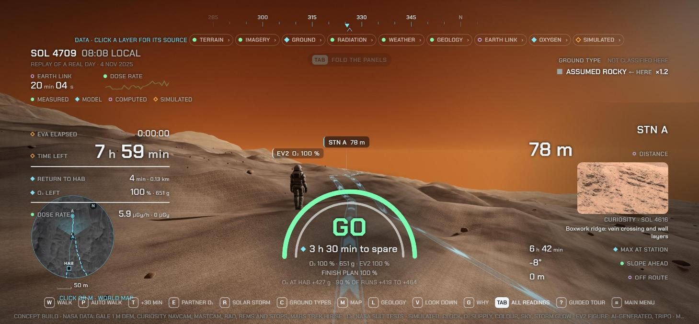

# SteadFast

A first-person view for an astronaut on a Mars surface EVA: the route ahead, the time left and
the moment to turn back, drawn on real NASA terrain and working without a link to Earth.

Entry for the NASA Space Apps Challenge 2026, challenge "Interplanetary Survival Guide: Martian
Map". Team of two, Taipei.



**Try it in a browser:** https://steadfast.eliasshieh.com (no login). The display was built for a
desktop screen. At phone size the layout does not work yet.

Source code: https://github.com/ting-hong-shieh/steadfast-mars-eva

## What the display does

Earth is 20 minutes away by radio, so the crew decides on the spot. While the astronaut
walks, the display answers three questions: which way, how much time and oxygen are left, and
when to turn back. The place, the ground and the stations are real NASA data. The weather and the
radiation replay one real day, sol 4709. The particle event is a real one from another day,
20 May 2024.

Every element on screen, how it is made, what it rests on and its limit is listed in
`docs/methods.md`. Every dataset, model, image, font and library is listed with its licence in
`SOURCES.md`.

## Run it locally

You need Node 20 or newer.

```bash
git clone https://github.com/ting-hong-shieh/steadfast-mars-eva.git
cd steadfast-mars-eva/app
npm install
npm run dev
```

The built data files are already in `app/public/data`, so no NASA download is needed to run the
app. The keys and the URL options are in `app/README.md`.

- Tests: `cd app && npm test`, then `npm run build && npm run capture` for screenshots in
  headless Chromium.
- Rebuild the terrain from the NASA files: see the top of `tools/build_gale_terrain.py`.
- Deploy: `cd app && npm run deploy` publishes `app/dist` to Cloudflare Workers. It needs the
  maintainer's Cloudflare login.

## What is in this repository

This repository holds the parts of the entry that are needed to run it and to check where its
numbers come from. The team works in a separate repository and copies these files here.

| Path | What it holds |
|---|---|
| `app/` | The web app: the helmet view, its built data files, 3D models and tests |
| `tools/` | Scripts that build the app's terrain, radiation, weather, sun, map, station and chemistry files and the ground-type model from NASA data |
| `data/metabolic/` | Tables from NASA suit tests and Apollo reports behind the oxygen model |
| `docs/methods.md` | Every element on screen, how it is made, what it rests on and its limit |
| `SOURCES.md` | Every source and its license |
| `AI_USE.md` | Where AI tools were used |
| `CREDITS.md` | Who did what |
| `LICENSE`, `NOTICE` | The Apache License 2.0 and the notice that goes with it |

## Use of AI tools

AI tools are used in this project for finding and reading sources, checking facts, writing code
and writing documentation. The idea of how to solve the challenge,
the features and the story come from the two team members. Every use is listed in `AI_USE.md`.

## Limits

- The app simulates what a person wearing a head-mounted display would see. It is not a real VR
  or AR build.
- The clock, the oxygen supply, the sky and light, the glow of the particle event, every sound,
  and the small rocks and ground look outside the measured square are simulated. No generated
  rock stays within 3 m of the planned route, and the route does not react to them. The screen marks
  each number as measured, model, computed or simulated.
- Walking speed, the EVA limit and the reserve are assumed numbers. `docs/methods.md` lists each
  one with its source.
- The stations are real Curiosity stops. The plan holds 25 minutes of work at each. What the
  crew does in them is not modelled.
- The route slows down on slopes and costs more oxygen on sand. No ground is treated as
  blocked. The route cannot see a rock smaller than the 1 m height data.
- The ground shown is a 600 m square. On the free walk the turn-back state appears only when
  the clock is moved forward by hand (key T). Two scenarios and two steps of the guided tour
  move it for that reason. The whole plan takes about 95 minutes of the 8 hours.

## License

The code and text written for this project are released under the Apache License 2.0. See
`LICENSE` and `NOTICE`. Third-party data, models, images, fonts and libraries keep their own
licences and terms, listed in `SOURCES.md`. Some rows there still wait for a person to check the
licence.

## Credits

Built by a team of two during NASA Space Apps 2026. Who did what is in `CREDITS.md`.
